<div align="center">


# 🍳 GanCook-10k

**A self-hosted family meal-ordering, grocery prep ledger, photo memory wall & outing tracker for your NAS.**

[](https://github.com/TenTh0usand/GanCook/releases)
[](https://nextjs.org/)
[](https://www.sqlite.org/)
[](#storage--backups)
[](LICENSE)

[中文](README.md) · English

</div>

---

**GanCook-10k** is an independently maintained, heavily customized family kitchen & dining web app forked from [Gloridust/GanCook](https://github.com/Gloridust/GanCook) (`v0.1.1`) and evolved through **`v0.8.1`** (`150+` files changed, `+17,300` lines, and 6 additive SQLite migrations).  
Built around the principle **"Lightweight, flexible, and low-friction"** — minimal required fields, automatic totals, and forgiving validation.

---

## 📸 Visual Tour (12 Live Mobile Screens)

<table>
  <tr>
    <td align="center" width="33%">
      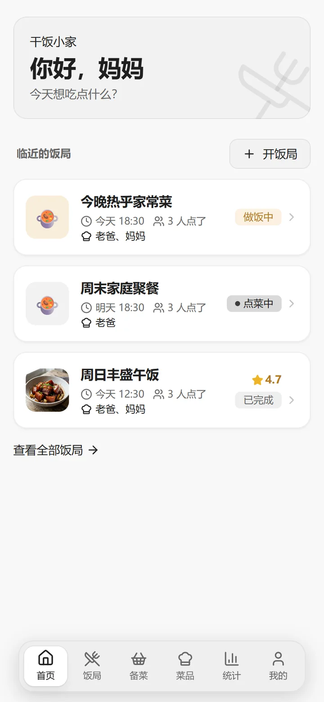<br/>
      <b>🏠 Home &amp; Upcoming Meals</b><br/><sub>Ordering, multi-cook cooking &amp; voted cover thumbnails</sub>
    </td>
    <td align="center" width="33%">
      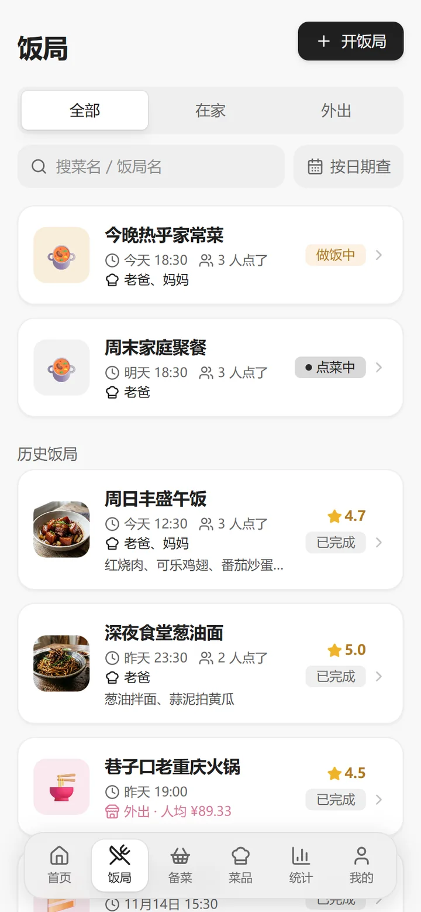<br/>
      <b>🍽️ Meals Search &amp; Filters</b><br/><sub>Search by date, dish, or venue &amp; filter All / Home / Out</sub>
    </td>
    <td align="center" width="33%">
      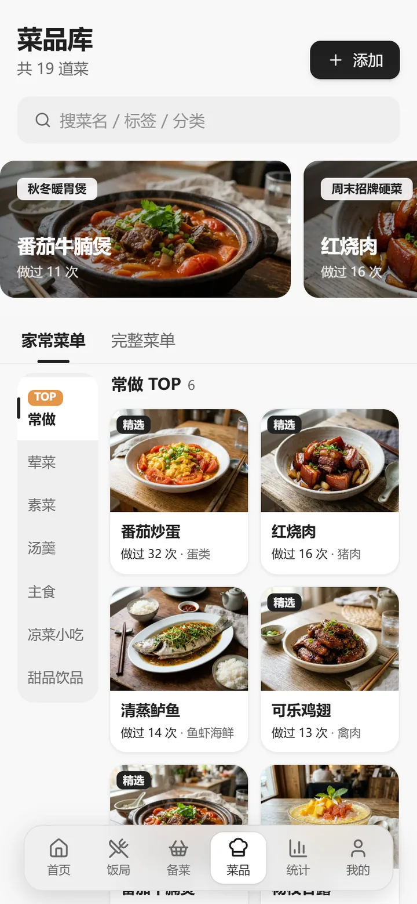<br/>
      <b>📖 Dual Menus &amp; Posters</b><br/><sub>Seasonal posters, Everyday / Full switch &amp; linked sidebar</sub>
    </td>
  </tr>
  <tr>
    <td align="center" width="33%">
      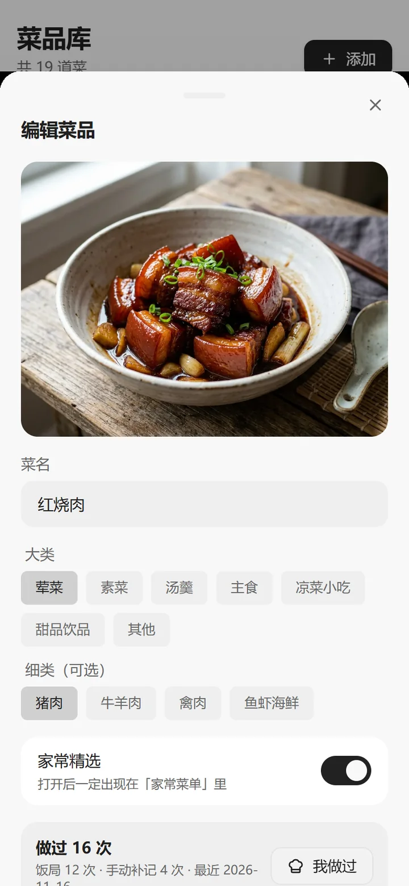<br/>
      <b>📝 Recipe Sheet &amp; Cook History</b><br/><sub>Photos, cooking notes, pinned toggle &amp; manual cook logs</sub>
    </td>
    <td align="center" width="33%">
      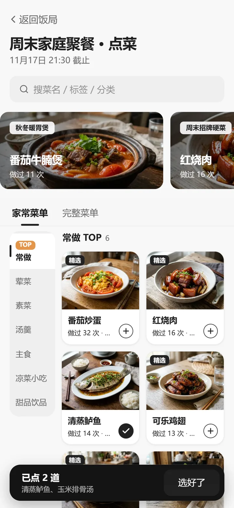<br/>
      <b>🛒 Full-Screen Ordering</b><br/><sub>Tap-to-pick 2-column menu with floating order bar</sub>
    </td>
    <td align="center" width="33%">
      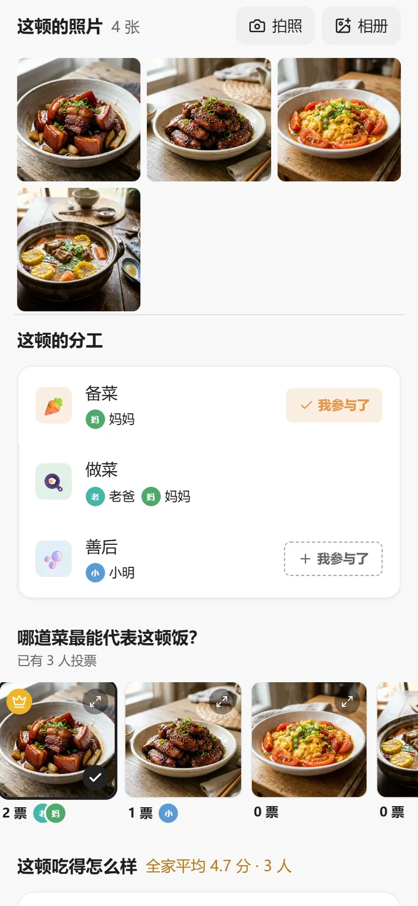<br/>
      <b>📷 Photo Wall &amp; Cover Vote</b><br/><sub>Client-compressed ≤2MB EXIF-free photos &amp; crown cover vote</sub>
    </td>
  </tr>
  <tr>
    <td align="center" width="33%">
      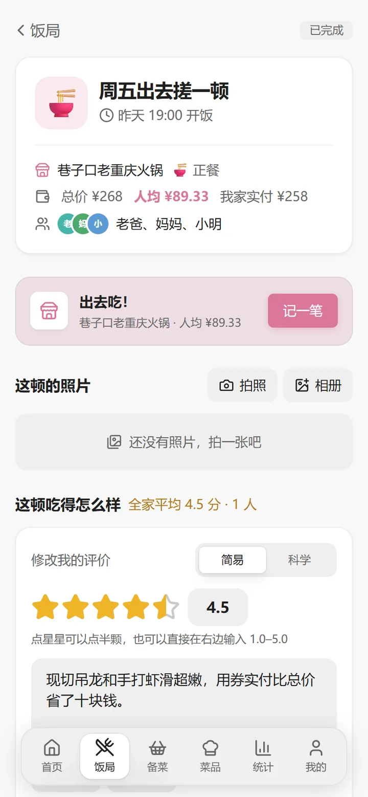<br/>
      <b>💸 Home ⇄ Going Out!</b><br/><sub>Money-burst effect, venue autocomplete &amp; split ledger</sub>
    </td>
    <td align="center" width="33%">
      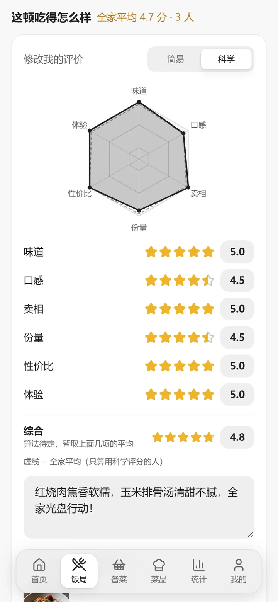<br/>
      <b>⭐ Quick &amp; 6-Axis Radar Ratings</b><br/><sub>0.5-star ratings, family-average SVG radar &amp; review photos</sub>
    </td>
    <td align="center" width="33%">
      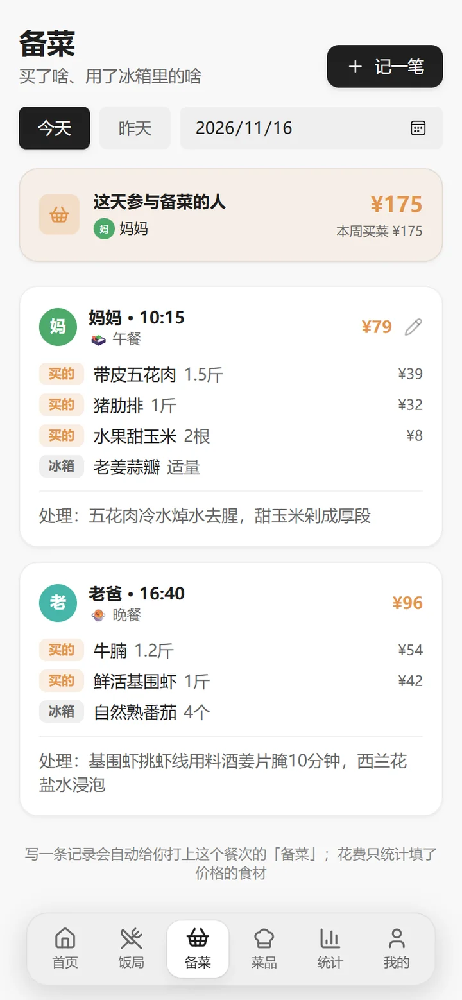<br/>
      <b>🥕 Grocery &amp; Prep Ledger</b><br/><sub>Track bought vs fridge ingredients with daily &amp; weekly spend</sub>
    </td>
  </tr>
  <tr>
    <td align="center" width="33%">
      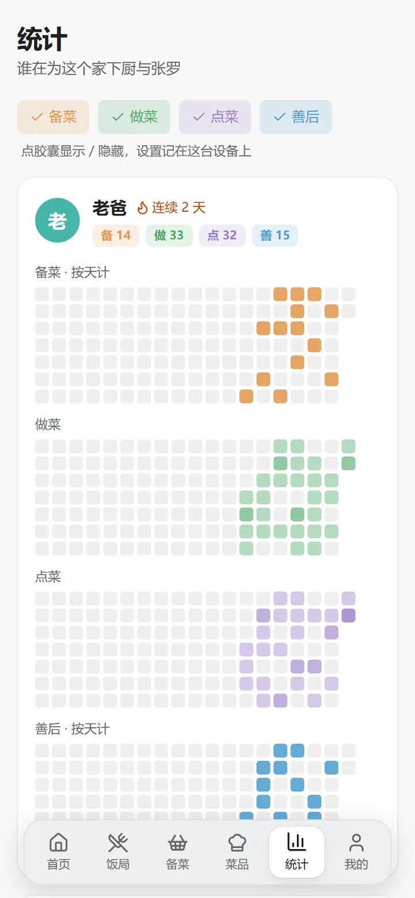<br/>
      <b>🌱 4-Role Kitchen Heatmaps</b><br/><sub>Prep, Cook, Order &amp; Cleanup grids with custom visibility</sub>
    </td>
    <td align="center" width="33%">
      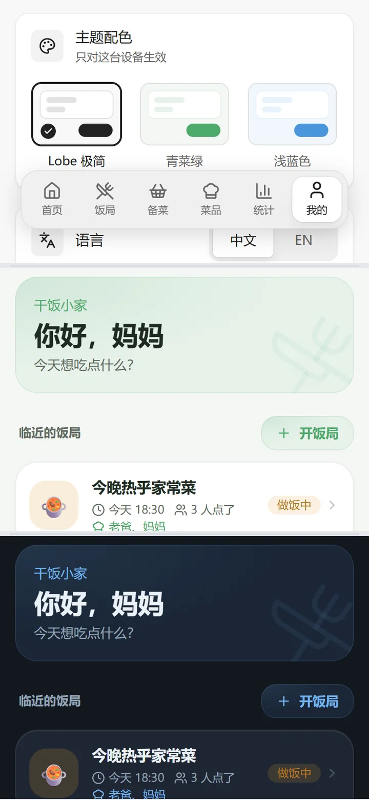<br/>
      <b>🎨 3 Day/Night Themes</b><br/><sub>0ms switching: Lobe Minimal (default), Fresh Green &amp; Sky Blue</sub>
    </td>
    <td align="center" width="33%">
      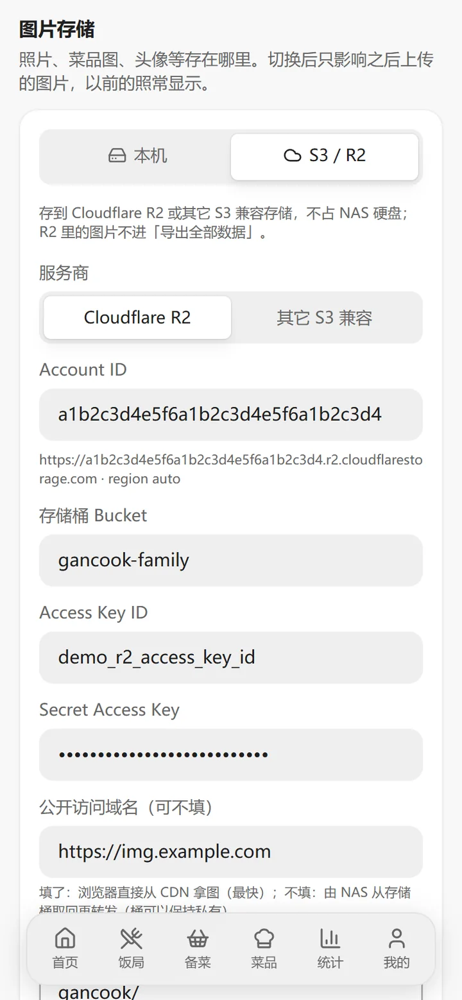<br/>
      <b>☁️ Cloudflare R2 &amp; Backups</b><br/><sub>AES-256-GCM encrypted credentials &amp; full JSON backup/restore</sub>
    </td>
  </tr>
</table>

---

## 🆚 Major Additions Over Upstream (`Gloridust/GanCook`)

- **👨‍👩‍👧 4-Role Chores & Multi-Cook Meals (`v0.2.0`)**: Expanded from single-cook ordering to **Prep (orange), Cook (green), Order (purple), and Cleanup (blue)** across **5 meal slots** (`Breakfast / Lunch / Snack / Dinner / Late Night`) with a `02:00 AM` day rollover boundary, plus per-role heatmaps on `/stats`.
- **📖 Dual Menus & Seasonal Posters (`v0.3.0`)**: Dedicated two-level `dish_categories` hierarchy, automated cook counts, **Everyday** vs **Full** menu tabs with scroll-linked left sidebar, seasonal feature banners, and manual *"I cooked this"* logging.
- **⭐ Quick Half-Star & 6-Axis Radar Ratings (`v0.4.0`)**: `0.5`-step ratings (`1.0–5.0`) alongside a 6-axis hexagonal SVG radar (`Taste, Texture, Looks, Portion, Value, Experience`) overlaid against the family average.
- **🥕 Grocery & Prep Ledger (`v0.5.0`)**: Log market purchases vs fridge items, prep notes, and receipt photos with automatic daily/weekly spend summaries that auto-credit the `Prep` chore.
- **🎨 Three Day/Night Themes & Full Data Transfer (`v0.5.2`–`v0.6.0`)**: Token-driven **Lobe (default)**, **Green**, and **Sky Blue** light/dark themes with instant switching, plus single-file **full JSON backup/restore (including images)** and dish library import/merge.
- **💸 Outing Toggle & Money-Burst (`v0.7.0`)**: Tap icon to switch **Home ⇄ Outing** (30-particle money-burst animation & `"Saved Money"` return effect), tracking venue autocomplete, category, total/headcount/per-person/actual paid, and companions — isolated from cooking/ordering stats. Added search by date/dish/venue and automatic purge of empty auto-generated meals after 3 days.
- **📷 Meal Photo Wall, Cover Voting & Cloudflare R2 Storage (`v0.8.0`–`v0.8.1`)**: Client-side compression (`≤ 2560px`, `≤ 2MB`) + server WebP/EXIF-stripping/480px thumbnails, review photos (up to 6 per review), democracy cover-photo voting (`👑`), Local / S3-compatible (**Cloudflare R2 optimized**) encrypted storage with `Content-Length` + 300KB 4-step self-test, later order deadlines, and one-tap order close for all family members.

---

## 🚀 Quick Start (Docker Compose)

```bash
git clone https://github.com/TenTh0usand/GanCook.git
cd GanCook
docker compose up -d --build
```

Open `http://<your-nas>:3000` — the first registered user becomes the family admin.

| Env Var | Default | Notes |
|---|---|---|
| `TZ` | `Asia/Shanghai` | Family timezone for day rollover & scheduling |
| `DATA_DIR` | `/data` (container) / `./data` (dev) | SQLite database, secrets, and local uploads |
| `AUTH_SECRET` | Auto-generated on first boot | JWT session signing & AES-256-GCM R2/S3 secret encryption |
| `CRON_SECRET` | Auto-generated on first boot | Optional auth token for `/api/cron/tick` |
| `COOKIE_SECURE` | Auto | Force `Secure` cookie (`1`) behind HTTPS proxies if needed |

---

## Storage & Backups

- **Photo Storage**: Switch anytime between local disk (`data/uploads/`) and S3-compatible buckets (with a dedicated **Cloudflare R2** setup flow using Account ID, Bucket, encrypted Secret Key, optional custom CDN domain, or transparent NAS proxy serving).
- **Backups**: All state lives inside `data/` (`app.db` + `uploads/`), or export a complete snapshot (tables + images) directly from **Admin → Data Import & Export**.

---

## 🛠️ Local Development

```bash
npm ci
cp .env.example .env.local
npm run db:migrate
npm run dev
```

Checks: `npx tsc --noEmit -p .`, `npm run lint`, and `npm run build`.

---

## 📄 License

[MIT](LICENSE) · Forked from [Gloridust/GanCook](https://github.com/Gloridust/GanCook) · Made with ❤️ for family dinners.
