<div align="center">


# 🍳 干饭厨子 · GanCook-10k

**自部署到家庭 NAS 的点菜、备菜、相册、外出账本与厨房分工系统**  
*让一家人每天的「今天吃啥」「谁买了菜」「谁掌了勺」「这顿值几分」「出去搓了哪顿」全部有迹可循。*

[](https://github.com/TenTh0usand/GanCook/releases)
[](https://nextjs.org/)
[](https://www.sqlite.org/)
[](#5--云端--本机双图片存储专按-cloudflare-r2-优化)
[](#8--三套主题日夜适配与全站数据备份)
[](LICENSE)

中文 · [English](README.en.md)

</div>

---

> **GanCook-10k** 基于优秀的开源家庭点菜项目 [Gloridust/GanCook](https://github.com/Gloridust/GanCook)（`v0.1.1`）深度二次开发并完全独立演进至 **`v0.8.1`**。  
> 在原版「轻量、单容器、SQLite、局域网/NAS 自托管」基因之上，累计重构与新增 **150+ 个文件（`+17,300` 余行代码）** 与 **6 套只增不删的平滑数据库迁移（`0001`–`0006`）**。
>
> **核心设计信条：轻量 · 自由 · 少报错** —— 通常只有名称必填，能不填就不填、能自动计算就绝不劳烦手动输入、不弹阻断式生硬报错。

---

## 📸 实机界面预览（12 屏全功能实拍）

<table>
  <tr>
    <td align="center" width="33%">
      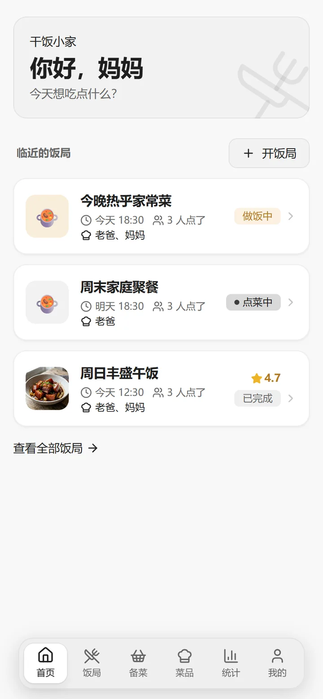<br/>
      <b>🏠 首页 · 临近饭局</b><br/><sub>点菜中 / 多人做饭中 / 已选封面的饭局卡片一眼看清</sub>
    </td>
    <td align="center" width="33%">
      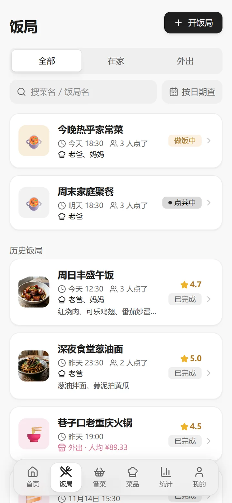<br/>
      <b>🍽️ 饭局总览与搜索</b><br/><sub>按日期 / 菜名 / 店名检索，一键筛选「全部 / 在家 / 外出」</sub>
    </td>
    <td align="center" width="33%">
      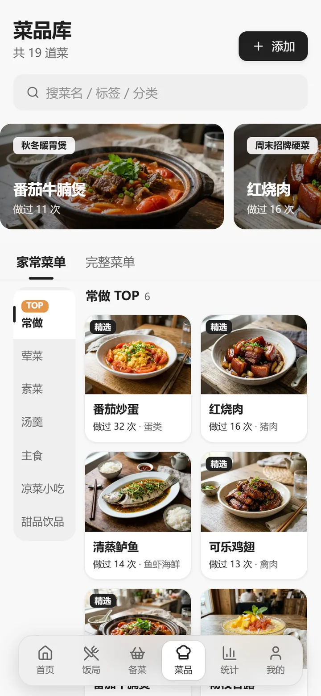<br/>
      <b>📖 奈雪式双菜单</b><br/><sub>顶部时令海报 + 家常 / 完整双菜单 + 左侧联动分类导航</sub>
    </td>
  </tr>
  <tr>
    <td align="center" width="33%">
      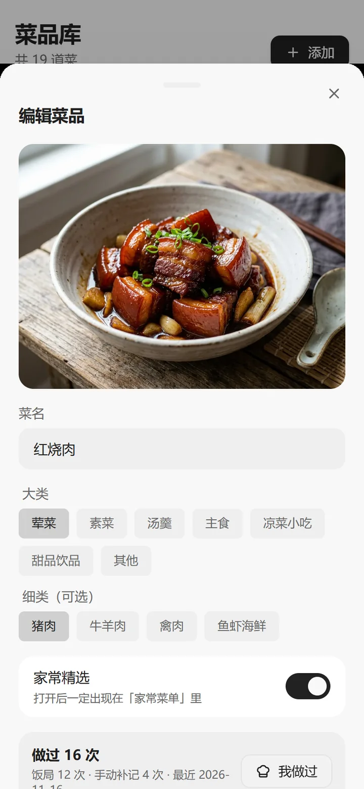<br/>
      <b>📝 菜谱详情与「我做过」</b><br/><sub>高清实拍 + 详细做法 + 分类精选开关 + 累计做过次数补记</sub>
    </td>
    <td align="center" width="33%">
      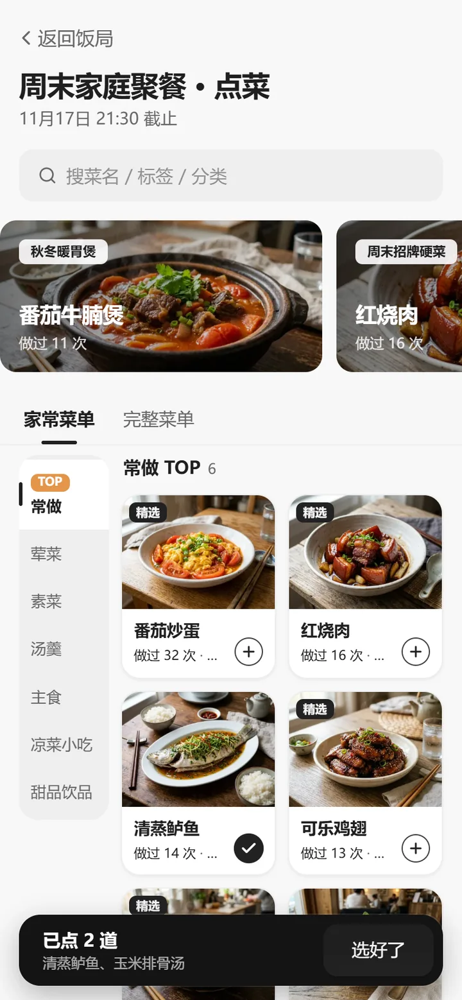<br/>
      <b>🛒 全屏沉浸点菜页</b><br/><sub>两列高清菜卡 + 即点即亮 ✓ 动效 + 底部悬浮已点清单</sub>
    </td>
    <td align="center" width="33%">
      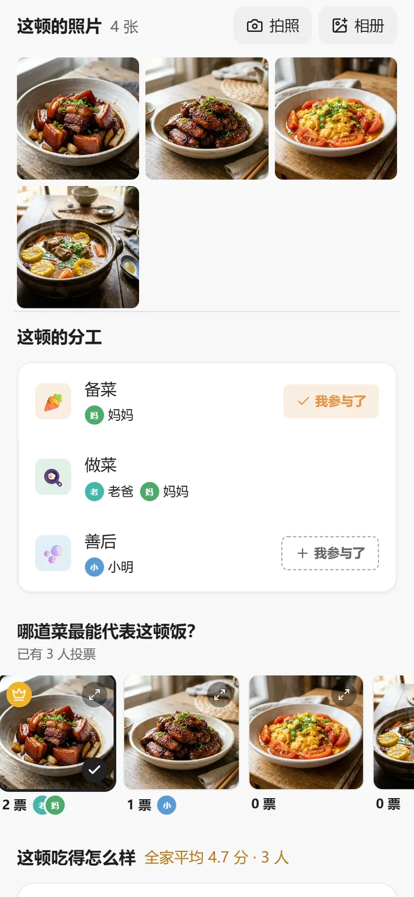<br/>
      <b>📷 本餐照片 &amp; 封面投票</b><br/><sub>自动压缩 ≤2MB 去 EXIF + 全家投票选出本顿「C 位封面菜」</sub>
    </td>
  </tr>
  <tr>
    <td align="center" width="33%">
      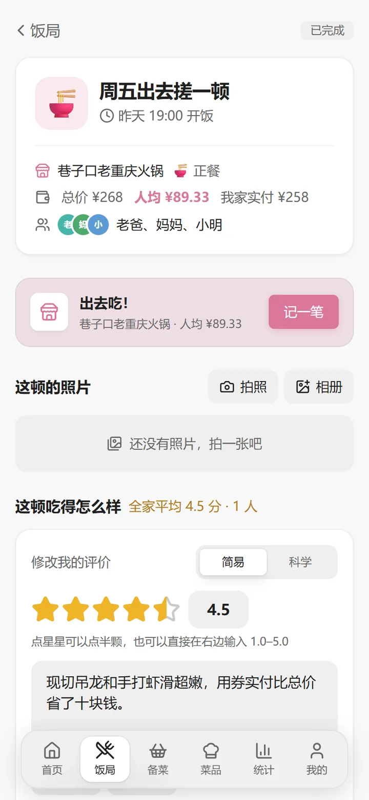<br/>
      <b>💸 在家 ⇄ 出去吃！</b><br/><sub>点图标撒钱特效切换外出，记录店名 / 人均 / 实付 / 同行</sub>
    </td>
    <td align="center" width="33%">
      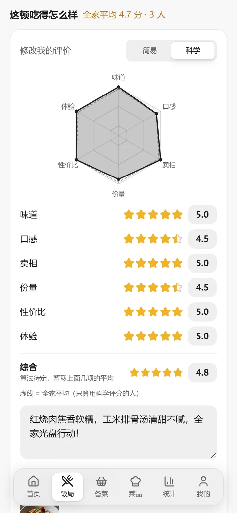<br/>
      <b>⭐ 双模式餐后评分 + 晒图</b><br/><sub>0.5 步进半星 或 六维科学雷达图（对比全家均值）+ 评价传图</sub>
    </td>
    <td align="center" width="33%">
      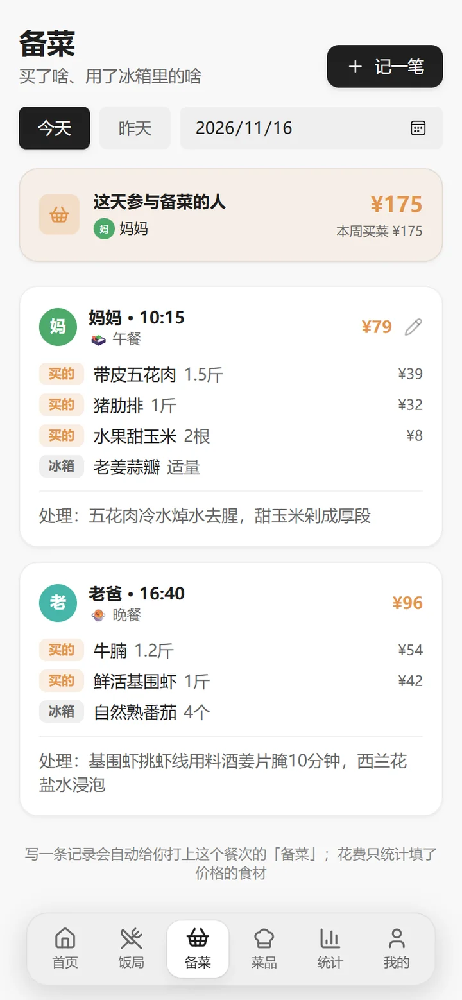<br/>
      <b>🥕 备菜与买菜账本</b><br/><sub>区分「买的 / 冰箱 / 其他」，自动汇总当日与本周买菜花费</sub>
    </td>
  </tr>
  <tr>
    <td align="center" width="33%">
      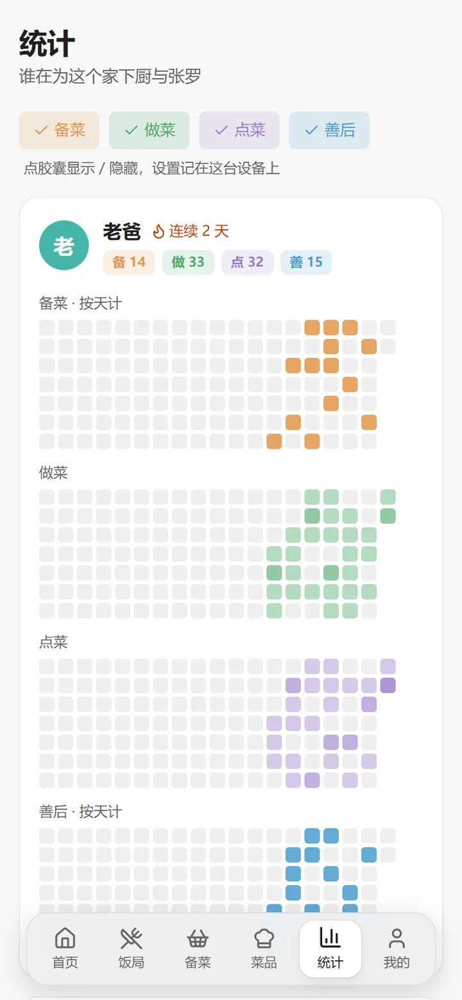<br/>
      <b>🌱 四色角色统计墙</b><br/><sub>备菜(橙) · 做菜(绿) · 点菜(紫) · 善后(蓝) 独立热力图可自由显隐</sub>
    </td>
    <td align="center" width="33%">
      <br/>
      <b>🎨 三套主题 · 0ms 切换</b><br/><sub>Lobe 极简（默认）/ 青菜绿 / 浅蓝色（含暗黑模式星夜适配）</sub>
    </td>
    <td align="center" width="33%">
      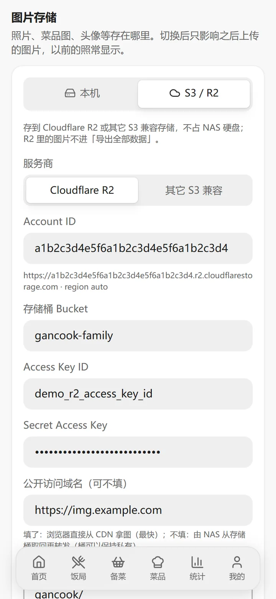<br/>
      <b>☁️ Cloudflare R2 &amp; 全站备份</b><br/><sub>AES-256 加密密钥 + 四步连接测试 + 全量 JSON（含图）导入导出</sub>
    </td>
  </tr>
</table>

---

## 🧭 一顿饭的全链路流转

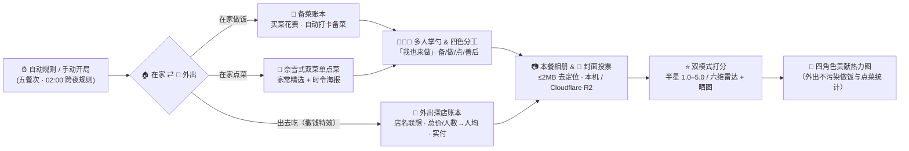

---

## 🆚 相比原版（Gloridust/GanCook）做了哪些核心改动？

| 维度 | 原版 `Gloridust/GanCook` | 定制版 `GanCook-10k`（`v0.8.1`） |
| :--- | :--- | :--- |
| **角色与家务分工** | 仅「谁做菜」与「点菜」双维度，一顿只能选 1 名厨师 | **备菜(橙) / 做菜(绿) / 点菜(紫) / 善后(蓝)** 四角色；按餐次打卡；**支持多人合做一顿饭**（「我也来做」）；备菜/善后按每人每天去重防刷次数 |
| **餐次与跨午夜逻辑** | 早餐 / 午餐 / 晚餐 3 餐次，按自然日结算 | 新增 **加餐 / 夜宵** 共 5 餐次；全站引入 **`02:00` 营业日分界**，凌晨 0 点后开夜宵不倒挂、不切日期 |
| **点菜截止流转** | 统一提前分钟数，仅管理员/发起人可提前截止 | 默认截止后调（早 `10:30` / 午 `14:30` / 晚 `21:30` 等），允许截止晚于开饭时间；**全家任意成员**都能手动点击「截止并开做 / 这顿吃完了」 |
| **菜谱组织与点菜页** | 单层标签筛选 + 列表卡片 | **独立二级分类表**（7 大类 + 12 细类）+ **奈雪式左侧联动导航** + **家常 / 完整双菜单** + **顶部横向时令海报** + **手动「我做过」记录** |
| **外出聚餐 / 点外卖** | 无 | **点击图标一键切换「在家 ⇄ 出去吃！」**，附确认弹窗 + **全屏撒钱 / 省钱粒子特效**，记录店名联想、分类、总价/人数自动算人均、实付与同行家人 |
| **本餐相册与封面投票** | 无饭局照片与评价配图 | **本餐照片墙**（每顿 60 张）+ **评价晒图**（每人 6 张）；客户端自动压至 `≤2MB`、服务端去 EXIF/GPS；**「哪道菜最能代表这顿饭？」** 全家投票选封面 |
| **图片存储引擎** | 仅容器本地磁盘 | **本机 / S3 兼容（Cloudflare R2 专项优化）** 一键切换；只用填 Account ID + 桶 + 密钥；Secret AES-256-GCM 加密存库；有公开域名 302 直出 CDN，无域名 NAS 自动中转 |
| **餐后评分体系** | 仅 1–5 整数星打分 | **简易（`0.5` 半星 / 小数输入）+ 科学六维（味道/口感/卖相/份量/性价比/体验 + SVG 雷达图对比全家均值）** 双模式 |
| **买菜备菜记录** | 无 | **独立「备菜」Tab**：记录买了啥 / 冰箱存货 / 处理步骤 / 小票照片，自动算当日 & 本周菜钱 |
| **历史查询与清理** | 分页列出，仅能视觉折叠空局 | 顶部 **按营业日 + 菜名/店名检索** + **全部/在家/外出筛选**；**空的自动饭局 3 天后自动彻底清理** |
| **主题、备份与部署** | 单一青菜绿；手动拷贝 `data/` 目录 | **Lobe 极简 / 青菜绿 / 浅蓝色** 三套日夜主题 `0ms` 无刷新切换；**网页端全站 JSON（含图片）一键备份恢复 & 菜品库分享**；宿主机 `Dockerfile.prebuilt` 秒级构建 |

---

## ✨ 八大定制功能详解

### 1. 👨‍👩‍👧 四色家务分工 & 多人共同掌勺（`v0.2.0`）
- 打破「一顿只能写一个人做饭」的限制，妈妈切配、爸爸炒大菜、孩子洗碗善后都能真实记上账；点菜页与饭局详情各自展示参与成员头像。
- 统计页提供四张独立彩色热力图：**做菜（绿）/ 点菜（紫）/ 备菜（橙）/ 善后（蓝）**，其中备菜与善后默认折叠隐藏（按设备本地记住显隐状态），既能看清全家付出又保持页面克制。

### 2. 📖 奈雪式双菜单 & 时令推荐海报（`v0.3.0`）
- **双视图共享同一份菜谱**：
  - **家常菜单**：自动收录管理员标记「精选」或最近 3 个月做过 `≥ 2` 次的拿手菜，日常点菜快人一步；
  - **完整菜单**：按「荤菜（猪/牛羊/禽/海鲜）/ 素菜 / 汤羹 / 主食 / 凉菜 / 甜品」二级分类分组展示，左侧一列吸顶导航点击平滑定位 + 滚动自动联动高亮。
- **时令海报**：管理员可在后台配置当前季节主推菜与海报图；未配置时自动兜底展示近 3 个月做得最多的菜。

### 3. 💸「在家 ⇄ 出去吃！」撒钱特效与探店账本（`v0.7.0`）
- 临时不想做饭或点外卖？在饭局详情轻点图标并确认，卡片随平滑翻转褪染为**莓果粉**，屏幕爆发 **30 个全屏飞舞钞票粒子特效（💸💵💰🪙）**；切回在家做饭则会弹出可爱的 **「省钱了 👛」** 提示。
- 已选好的在家点菜记录会安全隐藏而不丢失，随时切回即可恢复；外出记录自动隔离，**不会污染在家做饭和点菜贡献榜**。

### 4. 📷 本餐照片墙、评价晒图与封面投票（`v0.8.0`）
- **照片墙与智能回退**：有「这顿的照片」优先展示大合照；若只有家人留在评价里的配图，会自动在照片墙兜底呈现。全屏 Lightbox 支持左右滑动切换、点击放大与下拉手势关闭。
- **封面民主投票**：每顿饭可发起 **「哪道菜最能代表这顿饭？」** 投票（每人一票可改可撤，平票取最先到达），票王戴上小皇冠 `👑` 成为饭局列表与首页卡片的封面缩略图；无人投票时按饭局 ID 固定随机挑选。
- **手机端极速压缩 & 隐私擦除**：客户端用 Canvas 压至 `≤ 2560px` 且 `≤ 2MB` 再上传，服务端用 `sharp` 转为轻量 `.webp`、剥离照片中的 **EXIF / GPS 定位信息**，同时生成 480px 列表缩略图。

### 5. ☁️ 云端 / 本机双图片存储（专按 Cloudflare R2 优化）（`v0.8.0`–`v0.8.1`）
- 支持随时切换 **本机存储** 与 **S3 兼容（Cloudflare R2 专属表单，只需填 Account ID + 桶 + 密钥）**，旧图保持原路径原地读取不受影响。
- **四重安全与稳定保证**：
  1. `Secret Access Key` 使用 `AUTH_SECRET` 派生的密钥经 **AES-256-GCM** 加密存入 SQLite；全站导出自动剔除密钥，恢复备份自动保留当前存储配置。
  2. 直传签名先签后送原始字节并强制带上 `Content-Length`（彻底规避 R2 对大文件 chunked 传输返回 `411 MissingContentLength`）。
  3. 支持自定义公开域名 CDN（返回 302 跳转直连），不填也能走 NAS 服务端透明签名中转。
  4. 后台提供 **「上传 300KB 测试文件 → 读取 → 公开域名校验 → 清理删除」** 四步可视化排障测试，未通过绝不保存切换。

### 6. ⭐ 双模式评分与六维雷达图（`v0.4.0`）
- 日常随手给半星（`1.0–5.0`），遇到硬菜或新菜切到**科学评分**，从 **味道 / 口感 / 卖相 / 份量 / 性价比 / 体验** 六个维度打分，实时绘制六边形 SVG 雷达图并虚线叠加**全家平均分形状**。

### 7. 🥕 备菜与买菜账本（`v0.5.0`）
- 去菜市场买了什么、从冰箱翻出什么冻货、准备怎么焯水腌制，随手记一笔；保存记录后自动点亮当天该餐次的 **「备菜」** 打卡，并实时计算当日与本周买菜总花销。

### 8. 🎨 三套主题日夜适配与全站数据备份（`v0.5.2`–`v0.6.0`）
- **三套精致主题**：**Lobe 极简（默认，中性无彩高对比令牌）**、**青菜绿（原版经典暖青）**、**浅蓝色（晴空 / 星夜深蓝）**，均针对日间与暗黑模式精调发丝描边、层级投影与圆角，Cookie 按设备记忆、`0ms` 即时切换。
- **网页端数据导入导出**：支持导出**全站完整 JSON（含全部数据表 + 本地上传图片 base64）**与**纯菜品库分享包**；全量恢复在单事务内执行并在覆盖前自动在本地保留最多 5 份安全快照。

---

## 🚀 部署运行

### 方式一：标准 Docker Compose（一键启动）

```bash
git clone https://github.com/TenTh0usand/GanCook.git
cd GanCook
docker compose up -d --build
```

启动后访问 `http://<你的NAS地址>:3000`，首次打开按引导设置家庭名、管理员昵称和 6 位数字密码即可。

> [!TIP]
> **NAS 低性能主机快速构建**：在目标 NAS（Debian 12 / Node 22）宿主机上执行 `npm run build` 后，可直接使用仓库自带的 [`Dockerfile.prebuilt`](Dockerfile.prebuilt)（配合 `Dockerfile.prebuilt.dockerignore`）在 **1 分钟内**完成镜像更新，避免容器内重复构建耗时 20–30 分钟。

### 环境变量说明（全部可选，开箱即用）

| 变量名 | 默认值 | 说明 |
|---|---|---|
| `TZ` | `Asia/Shanghai` | 家庭时区，决定营业日分界与自动饭局触发时刻 |
| `DATA_DIR` | `/data`（容器）/ `./data`（本地） | SQLite 数据库、自动生成的密钥与本地图片根目录 |
| `AUTH_SECRET` | 首启自动生成持久化 | 用于 JWT 会话签名与加密数据库里的 R2/S3 Secret |
| `CRON_SECRET` | 首启自动生成持久化 | 手动触发 `/api/cron/tick` 调度心跳时使用 |
| `COOKIE_SECURE` | 自动按协议判断 | 纯内网 HTTP 可开箱登录；HTTPS 反代识别异常时可设为 `1` |

---

## 🛠️ 本地开发与验证

```bash
npm ci
cp .env.example .env.local
npm run db:migrate
npm run dev
```

常用工程质量检查：

```bash
npx tsc --noEmit -p .
npm run lint
npm run build
```

---

## 💾 数据备份

- **文件级备份**：只需定期打包宿主机挂载的 `data/` 目录（含 `app.db`、`uploads/` 与 `.secret` 密钥文件）。
- **网页端备份**：管理员可在「我的 → 家庭管理 → 数据导入与导出」一键下载全站完整备份 JSON 或仅导出菜品库分享给亲友。

---

## 📅 版本演进记录

| 版本 | 核心里程碑 |
| :--- | :--- |
| `v0.1.0-baseline` | 自上游 `Gloridust/GanCook`（`v0.1.1`）分叉基准 |
| `v0.2.0` / `v0.2.1` | **P1**：四色角色分工、按餐次打卡、多人做菜、跨午夜加餐/夜宵、`Dockerfile.prebuilt` 秒级部署 |
| `v0.3.0` | **P2**：二级分类体系、做过次数统计、家常/完整双菜单、时令海报、奈雪式全屏点菜 |
| `v0.4.0` | **P3**：半星简易评分 + 六维科学评分 SVG 雷达图 |
| `v0.5.0`–`v0.5.3` | **P4**：备菜买菜账本、`02:00` 跨夜规则、登录防爆破、UI 质感打磨与青菜绿/浅蓝双主题 |
| `v0.6.0` | **Lobe 极简**主题上线、网页端全站数据（含图）& 菜品库一键导入导出 |
| `v0.7.0` | **P5（部分）**：历史饭局搜索、3 天空自动饭局清理、点击图标「在家 ⇄ 出去吃」撒钱特效 & 探店账本 |
| `v0.8.0`–`v0.8.1` | 本餐相册（`≤2MB` 去 EXIF）、评价传图、代表菜封面投票、本机 / Cloudflare R2 存储（含 `411` 修复与 300KB 连通自检）、点菜截止延后与全员手动截止 |

---

## 🗺️ 待办与后续探索（Roadmap）

- [ ] **本餐分享卡片（朋友圈 / 小红书）**：一键把这一餐（实拍封面 / 照片墙、点菜清单或探店人均、掌勺分工、半星 / 六维雷达评分与评价金句）生成适合发朋友圈或小红书（如 `3:4` 比例）的分享卡片
- [ ] **接入 Agent 开放能力**（*不在应用内写死特定文件的硬编码解析器，统一把各类格式文件直接输入给 AI，由 AI 通过开放接口调用及标准导入导出能力读写 GanCook*）：
  - [ ] **精美菜谱 AI 设计**：从**五星酒店 / 黑珍珠 / 米其林**等超高端仪式感菜谱，到**街边小馆 / 市井手写牌**等接地气烟火风菜谱的多风格设计生成
  - [ ] **多格式文档导入菜谱**：直接把 `.md`、`.html` 等文档丢给 AI 提取整理后批量导入菜品库
  - [ ] **今日饭局 · AI 视频分享**：结合静态分享卡片与动态模板，借助 AI 生成可直接发布的「今日饭局」短视频
- [ ] **外出足迹、饮食花费统计与精细菜价库**（P5 剩余 / P6）：统计页外出热力图、买菜+外出周/月花费对比、规格化食材每斤比价区间
- [ ] **冰箱库存联动、自动买菜清单与消息推送提醒**

---

## 📄 开源协议

基于 [MIT License](LICENSE) 开源 · 致谢原作者 [@Gloridust](https://github.com/Gloridust/GanCook) · Made with ❤️ for family dinners.
